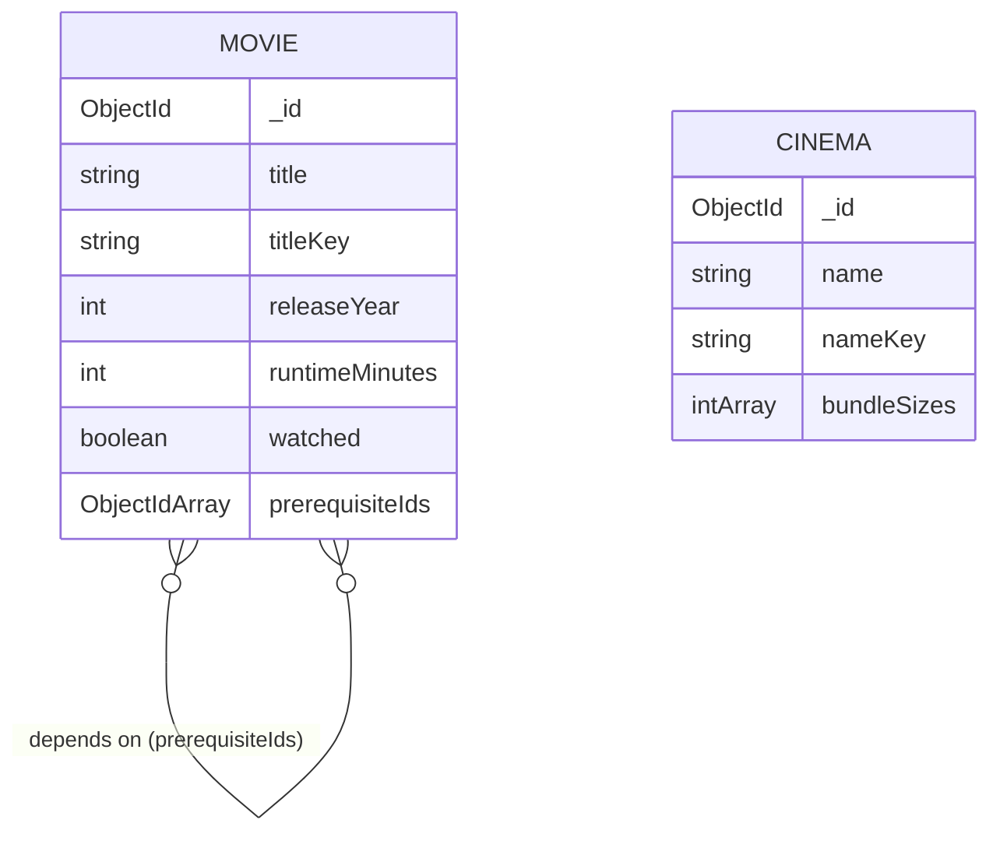

# Doomsday Ready

**Doomsday Ready** is a full-stack web app built for MCU fans getting ready for *Avengers: Doomsday*. It helps you track which movies you have watched, figure out the right order to rewatch prerequisite movies before any target film, and calculate the fewest seat bundles to buy for an opening-night cinema watch party without paying for empty seats.

---

## Tech Stack

- **Frontend:** Next.js 16 (App Router), React 19, Tailwind CSS 4 (JavaScript)
- **Backend:** Node.js, Express 5 (ES Modules)
- **Database:** MongoDB with Mongoose
- **Testing:** Node built-in test runner (`node:test` and `node:assert/strict`)

---

## Main Features

### 1. Movies & Rewatch Order
- Create movies with a unique title, release year, runtime (`1–300` minutes), optional prerequisites, and watched status (`false` by default).
- Toggle watched status and update prerequisites at any time.
- Blocks direct or indirect circular dependencies (for example, `A → B → A`) with HTTP `409` and error code `CIRCULAR_DEPENDENCY`.
- Given any target movie, returns all required prerequisite movies in a valid viewing order where every prerequisite comes before the movie that depends on it. Each movie appears once, and the target movie itself is excluded.
- Calculates how many prerequisites are watched and the total remaining watch time for the unwatched ones.

### 2. Cinemas & Watch-Party Booking
- Create cinemas with a unique name and `1–10` distinct seat bundle sizes (each between `1` and `500` seats).
- Given a cinema and a group size (`1–10,000`), finds the smallest number of bundles that add up to the exact group size.
- If no exact combination is possible, returns `possible: false`.

### 3. Frontend Views
- **Dashboard (`/`):** Streaming-style hero showcase with interactive movie spotlight and quick navigation.
- **Movies (`/movies`):** Add new movies, filter/search your collection, toggle watched status, and edit prerequisites inline.
- **Rewatch Plan (`/rewatch`):** Pick a target movie, see the ordered rewatch list, check the progress bar, and mark prerequisites watched directly from the plan.
- **Booking (`/booking`):** Pick a cinema, enter a group size, and see the exact bundle breakdown or a clear "not possible" message.

---

## Project Structure

```text
doomsday_ready/
  client/                     # Next.js frontend (port 3000)
    public/images/            # Custom movie posters, 16:9 hero images, and logo
    src/
      app/                    # App Router pages (/, /movies, /rewatch, /booking)
      components/             # UI components (.jsx)
      lib/                    # API helper and artwork mapping (.js)
  server/                     # Express backend (port 5000)
    scripts/seed.js           # Idempotent sample data seeder
    src/
      controllers/            # Request validation and response formatting
      models/                 # Mongoose schemas (Movie, Cinema)
      routes/                 # Express routes under /api
      services/               # Manual graph and booking algorithms
      server.js               # Express app and MongoDB connection
    tests/                    # Unit tests for graph and booking logic
```

---

## Data Model Diagram



`Movie` and `Cinema` are stored in separate MongoDB collections. Booking quotes are calculated on demand from a cinema's `bundleSizes`, so a separate booking collection is not needed for this scope.

---

## Getting Started Locally

### Prerequisites
- **Node.js** (v20+ recommended) and **npm**
- A **MongoDB** connection URI (MongoDB Atlas free cluster or local MongoDB Community server)

### 1. Clone the repository

```powershell
git clone https://github.com/ashiqurrhmn/doomsday_ready.git
cd doomsday_ready
```

### 2. Set up the Backend (`server`)

```powershell
cd server
npm install
Copy-Item .env.example .env
```

Open `server/.env` and set your MongoDB connection string:

```dotenv
PORT=5000
MONGODB_URI=your_mongodb_connection_string
```

Seed the sample movies and cinemas (safe to run multiple times without creating duplicates):

```powershell
npm run seed
```

Start the backend server:

```powershell
npm run dev
```

The API will run at `http://localhost:5000` (health check: `GET http://localhost:5000/api/health`).

### 3. Set up the Frontend (`client`)

Open a second terminal:

```powershell
cd client
npm install
Copy-Item .env.example .env.local
npm run dev
```

`client/.env.local` points Next.js `/api/*` rewrites to the Express backend:

```dotenv
API_ORIGIN=http://127.0.0.1:5000
```

Open `http://localhost:3000` in your browser.

---

## Running Tests, Lint, and Build

Backend unit tests (10 tests covering graph ordering, cycle detection, and all booking examples):

```powershell
cd server
npm test
```

Frontend lint and production build:

```powershell
cd client
npm run lint
npm run build
```

---

## API Reference

All routes are served under `/api`. Errors follow a consistent JSON shape:

```json
{
  "error": {
    "code": "CIRCULAR_DEPENDENCY",
    "message": "This update would create a circular dependency"
  }
}
```

### Movies

| Method | Endpoint | Description |
| --- | --- | --- |
| `POST` | `/api/movies` | Create a new movie |
| `GET` | `/api/movies` | List all movies with populated prerequisites |
| `PATCH` | `/api/movies/:id` | Update movie fields (`watched`, `prerequisiteIds`, `title`, `releaseYear`, `runtimeMinutes`) |
| `GET` | `/api/movies/:id/rewatch-order` | Get the ordered prerequisite list, watched count, and remaining runtime |

#### Example: `POST /api/movies`
```json
{
  "title": "Iron Man",
  "releaseYear": 2008,
  "runtimeMinutes": 126,
  "prerequisiteIds": [],
  "watched": false
}
```

#### Example: `GET /api/movies/:id/rewatch-order`
```json
{
  "targetId": "673f...",
  "targetTitle": "Captain America: Civil War",
  "movies": [
    { "_id": "...", "title": "Iron Man", "releaseYear": 2008, "runtimeMinutes": 126, "watched": true },
    { "_id": "...", "title": "Captain America: The First Avenger", "releaseYear": 2011, "runtimeMinutes": 124, "watched": false },
    { "_id": "...", "title": "The Avengers", "releaseYear": 2012, "runtimeMinutes": 143, "watched": false }
  ],
  "totalMovies": 3,
  "watchedCount": 1,
  "remainingRuntimeMinutes": 267
}
```

### Cinemas & Booking

| Method | Endpoint | Description |
| --- | --- | --- |
| `POST` | `/api/cinemas` | Create a cinema with bundle sizes |
| `GET` | `/api/cinemas` | List all cinemas |
| `GET` | `/api/cinemas/:id/booking?groupSize=6` | Calculate the minimum exact seat bundles for a group |

#### Example: `POST /api/cinemas`
```json
{
  "name": "Stark Cinema",
  "bundleSizes": [1, 3, 4]
}
```

#### Example: `GET /api/cinemas/:id/booking?groupSize=6`
```json
{
  "cinemaId": "673f...",
  "cinemaName": "Stark Cinema",
  "groupSize": 6,
  "possible": true,
  "totalBundles": 2,
  "bundles": [
    { "size": 3, "quantity": 2 }
  ]
}
```

If no exact combination is possible (for example, bundles `[4, 6]` with `groupSize=7`), the endpoint returns HTTP `200` with `"possible": false`, `"totalBundles": null`, and `"bundles": []`.

---

## How the Core Logic Works

Both core algorithms are written from scratch without external graph or optimization libraries.

### 1. Cycle Detection & Rewatch Order (`server/src/services/movieGraph.js`)
- **Cycle Detection (`hasCircularDependency`):** Before saving a prerequisite update, the server builds an in-memory map of movie dependencies with the proposed changes and runs a Depth-First Search (DFS) from the updated movie. It tracks nodes currently on the active recursion stack (`visiting`) and nodes already cleared (`visited`). If DFS reaches a node that is currently in `visiting`, a cycle exists and the request is rejected with `409 CIRCULAR_DEPENDENCY` without modifying the database.
- **Rewatch Order (`buildRewatchOrder`):** Starting from the target movie's direct prerequisites, a recursive post-order DFS visits each prerequisite's own prerequisites first, marks each movie in a `visited` set so shared prerequisites are never repeated, and pushes each movie into the result list only after all of its dependencies have been added. The target movie itself is not added.

### 2. Minimum Bundle Booking (`server/src/services/booking.js`)
- **Why greedy fails:** Picking the largest bundle first does not always give the fewest bundles (for example, with bundle sizes `[1, 3, 4]` and group size `6`, greedy picks `4 + 1 + 1` = 3 bundles, while `3 + 3` = 2 bundles).
- **Dynamic Programming (`getMinimumBundleQuote`):** We build an array `minimumBundles[0..groupSize]` initialized to `Infinity` with `minimumBundles[0] = 0`, along with `lastBundle[0..groupSize]`. For each seat count from `1` to `groupSize`, we try every available bundle size `b <= seats` (sorted largest to smallest) and check if `minimumBundles[seats - b] + 1` improves the current best count. At the end, if `minimumBundles[groupSize]` is still `Infinity`, no exact match exists. Otherwise, we backtrack through `lastBundle` from `groupSize` down to `0` to count how many of each bundle size were used.

---

## Assumptions & Notes

- **Case-insensitive unique names:** Movie titles and cinema names are trimmed and checked case-insensitively using normalized `titleKey` and `nameKey` fields (so `"Iron Man"` and `" iron man "` are treated as the same title).
- **Release year & runtime:** The prompt states *"Release year and runtime in minutes: 1–300"*. We treat `1–300` as the runtime limit in minutes and validate `releaseYear` as a positive integer.
- **Duplicate IDs / bundle sizes:** Duplicate prerequisite IDs in a movie request or duplicate numbers in `bundleSizes` are rejected with HTTP `400 VALIDATION_ERROR`.
- **Tie-breaking in booking quotes:** When two different exact combinations use the same minimum number of bundles, bundle sizes are evaluated from largest to smallest and the first minimum match is kept for deterministic output.
- **Seed data values:** Release years and runtimes in `server/scripts/seed.js` (including *Avengers: Doomsday* set to `2026` and `180` minutes) are sample demonstration values matching the assessment prompt.

---

## AI Usage

I used AI tools as a helper while building this project in a few specific ways:

- **Planning and structure:** Breaking the assessment down into small steps across the Next.js frontend, Express API, and MongoDB models, and double-checking validation rules.
- **Checking the algorithms and tests:** Reviewing my manual DFS graph logic (for cycle detection and rewatch order) and dynamic programming booking logic, and writing unit tests with `node:test` for the assessment examples and edge cases. No external libraries were used to solve Feature 1 or Feature 2.
- **UI design and artwork:** Helping style the React + Tailwind CSS components (including the streaming hero layout and glassmorphism UI) and generating/upscaling the custom movie posters, widescreen hero backgrounds, and SVG logo.
- **Debugging and docs:** Setting up the Next.js `/api` rewrite proxy to Express and organizing this README and the Mermaid data-model diagram.
